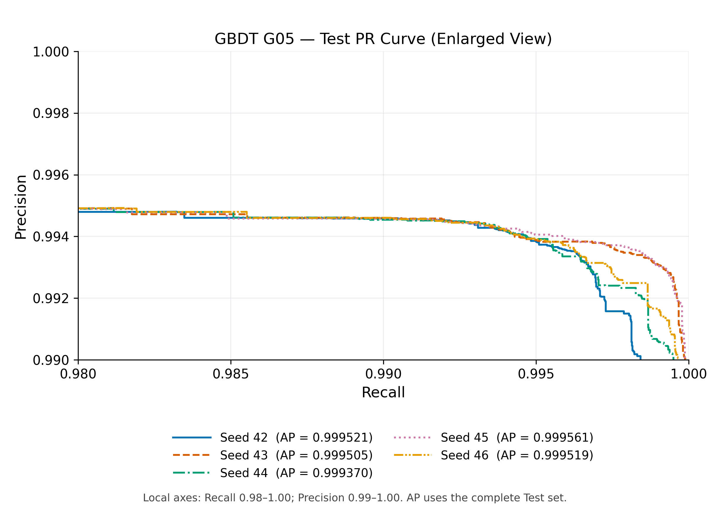

# P4 Paper Text

## §3.3 Methods — Gradient Boosted Decision Trees

Gradient boosted trees estimate attack probability by adding trees sequentially to an ensemble. Each step uses derivatives of the current loss to fit the next tree. We used scikit-learn's HistGradientBoostingClassifier with binary log loss and a learning rate that scales each update. Numerical features are binned before split evaluation, reducing the number of candidate split points.

We trained eight predefined configurations with seeds 42–46 on 1,764,265 flows, for 40 fits in total. Each run used the same 140 P2 features, fixed preprocessing, and training sample weights. No additional class weights were applied. Configurations were ranked by mean average precision (AP) across five seeds on 367,036 validation flows. Differences within 1e-6 were resolved by choosing the smallest configuration ID. G05 was selected with mean validation AP of 0.999792. It used 400 iterations, learning rate 0.05, at most 31 leaves per tree, minimum leaf size 20, L2 regularization 1.0, and 255 bins. Early stopping was disabled. A fixed Random Forest with 200 trees provided an auxiliary control. The test set was excluded from model selection and threshold calibration.

The 40 fits ran serially with four training threads and an 8 GiB Windows Job memory limit. Recorded fitting time totaled 13,472.81 seconds, or 3.74 hours, excluding loading, validation scoring, serialization, and manual checkpoints. Two G02 fits included Modern Standby interruptions, so this total includes time when computation was suspended. For G05, mean fitting time was 500.10 ± 15.02 seconds across the five model seeds.

Although individual features summarize flow timing, the classifier does not model the order of successive flows. The sample weights distinguish benign traffic from attacks but do not give separate emphasis to rare attack families. High aggregate AP can therefore coexist with uncertain detection performance for sparsely sampled families. The stratified evaluation also leaves performance under temporal distribution shifts untested.

## §4.1 Results — Tree Models on the Held-out Test Set

The test set contained 346,544 flows, comprising 282,506 benign records and 64,038 attacks. Evaluation reused the five selected G05 models without refitting. Across seeds 42–46, test AP was 0.999495 ± 0.000073 and ROC-AUC was 0.999907 ± 0.000011. All reported deviations are sample standard deviations across seeds, calculated with ddof=1. Figure P4-1 shows the five test precision–recall curves, and Table P4-1 lists the principal metrics. The plotted region is enlarged, but each AP value uses the complete test set.

For thresholds fixed using benign validation scores at a target FPR of 1%, G05 achieved test Macro-F1 of 0.987784 ± 0.003178 and TPR of 0.999966 ± 0.000007. The observed test FPR was 0.009169 ± 0.002436. With the additional validation target of 5%, Macro-F1 was 0.943272 ± 0.002022, TPR was 0.999997 ± 0.000007, and FPR was 0.045063 ± 0.001719. The thresholds were not adjusted to make the test FPR match either validation target.

The fixed Random Forest was evaluated on the same test flows with the same five seeds. Its AP was 0.999227 ± 0.000162 and ROC-AUC was 0.999842 ± 0.000032. At thresholds calibrated for 1% validation FPR, test Macro-F1 was 0.984652 ± 0.000404, TPR was 0.999928 ± 0.000009, and FPR was 0.011550 ± 0.000310. Comparisons between methods and paired statistical analyses are presented in Section 4.4.

All 14 expected attack families were present, although Heartbleed, SQL injection, and infiltration contributed only two, three, and five samples. These counts provide limited evidence about rare attack detection. G05's empirical test ROC gave TPR of 0.932409 ± 0.025695 at FPR ≤0.1%. This lower recall at a strict false alarm limit complements aggregate AP. This statistic describes the test ROC and does not specify a validation-calibrated operating threshold. The results apply to the stratified split and do not establish performance on later traffic or unseen attacks.

### Figure P4-1 — G05 Test precision–recall curves

**Figure P4-1.** Precision–recall curves for GBDT G05 on the held-out Test set, shown separately for seeds 42–46. The axes show recall from 0.98 to 1.00 and precision from 0.99 to 1.00. Each legend AP value uses all 346,544 test predictions for that seed. Curves are neither smoothed nor averaged. [Vector PDF](../figures/fig_m1_test_pr.pdf).

### Table P4-1 — G05 Test metrics

**Table P4-1.** GBDT G05 Test metrics, reported as five-seed means ± sample standard deviations (ddof=1). All values are proportions on a 0–1 scale. Classification metrics use thresholds set separately for each seed on benign validation scores at a target FPR of 1%. These thresholds remain fixed on the test set.

| Test metric | Mean ± sample SD | Operating rule |
|---|---:|---|
| AP | 0.999495 ± 0.000073 | Threshold-independent |
| ROC-AUC | 0.999907 ± 0.000011 | Threshold-independent |
| Macro-F1 | 0.987784 ± 0.003178 | Frozen Validation 1% FPR threshold |
| TPR | 0.999966 ± 0.000007 | Frozen Validation 1% FPR threshold |
| Actual FPR | 0.009169 ± 0.002436 | Frozen Validation 1% FPR threshold |

## 数据来源与写作核对（不计入正文词数）

- **文字复核**：两节正文各 300 个英文词（空白分词，不含标题、图表和图注），Methods 保持四段。删除正文中的分号、冒号及交付式说明，保留必要术语。流内时间特征与跨流时序建模明确区分；罕见类局限按样本数量和二分类权重表述，不断言已经证明检测能力差。正文未引用外部文献，未添加未经核实的引文。
- **Validation 与 Test 分开**：[results/m1.json](../results/m1.json) 明确标记 `validation_only=true`，仅支持 Methods 中的搜索与选优说明。Results 正文来自 [正式 Test 摘要](../results/m1_test_summary/summary.json)，不是 Validation 分数。G05 Test AP、ROC-AUC 保留四位小数分别为 **0.9995、0.9999**。
- **搜索与选优**：[GBDT 搜索摘要](../results/m1_gbdt_summary/summary.json)、[selection.json](../results/m1_gbdt_summary/selection.json) 与 [正式执行配置](../methods/m1/execution.gbdt-search.v1.json) 共同支持八配置、五种子、G05 参数及 `1e-6` 平分规则。G05 Validation AP 均值为 `0.9997917266981542`；未将其写成 Test 结果。
- **训练耗时口径**：从搜索摘要中逐项累加全部 40 个 `fit_seconds_raw`，得到 `13472.807083800144` 秒，即约 `3.742446` 小时。它不包含加载、评分、序列化或人工检查点；G02 的 seed 42、44 含 Modern Standby 中断，正文已说明，不扣除、不当作纯计算时间。G05 的 `500.10 ± 15.02` 秒为五种子拟合耗时均值及样本标准差。
- **统计与阈值口径**：正文所有 `±` 均表示五种子样本标准差（`ddof=1`），不是置信区间；TPR、FPR、Macro-F1 均以 0–1 比例报告。固定阈值分类指标来自 `five_seed_summaries`；0.1% FPR 下的 TPR 从 G05 五份 `per_seed_threshold_records` 中各取一份经验 ROC 结果再汇总，未重复计算两组阈值记录，也未用 Test 重新标定部署阈值。
- **不提前比较**：RF 仅独立描述绝对指标；不写 GBDT/RF 优劣、Bootstrap 差值、显著性或与 M2/M3 的比较。统一比较留给 §4.4。
- **图片口径**：[原 PR 图](../figures/fig_m1_pr.png) 属于 G05 Validation Enlarged View，仍保持不变；本文 Figure P4-1 使用另行生成的 [Test PR 图](../figures/fig_m1_test_pr.png)，两者文件名、标题与数据来源均分开。Test 图的 [可复现脚本](../tools/plot_m1_test_pr.py) 和 [SHA256 验收报告](m1_test_pr_curve_report.md) 一并保留。
- **验收**：五种子各 346,544 行 Test 标签与行 ID 完全一致，AP 与 ROC-AUC 独立复算均与封存值严格一致；原 Test 归档 82/82 文件在绘图前后通过 SHA256。12 项既有 PR 专项测试及新 Test 图的合成排版、分辨率、图例、表格核对通过。首次沙箱内测试受 Windows 临时目录权限阻止，原命令在获准的沙箱外重跑后 12/12 通过，未修改测试。
- **本轮范围**：初稿仅核对已有公开摘要；补图阶段只解码已封存的五份 G05 Test 预测，复算既有 AP/ROC-AUC 并生成 PR 曲线。没有读取 Test Parquet、加载或重训模型、重新选优、标定阈值、运行 Bootstrap、修改封存结果或执行 Git 提交/推送。

| 核对文件 | SHA256 |
|---|---|
| `results/m1.json` | `a4b06bc1de785aefba7ab542697d04de21990eb85de30e903ebbc6afb3f2539f` |
| `results/m1_gbdt_summary/summary.json` | `c2ded03f3354b61697156384d8a461fdcda78fb4b8451d13ed0a12f72dcf086c` |
| `results/m1_gbdt_summary/selection.json` | `859a883fe6ecc12246fb2f08c5ab3e2707530a6906f52c1c2863d9b12ba0d2c9` |
| `results/m1_test_summary/summary.json` | `cb2a95db154792d5dc0d3fb5f2710aba3ed6cc04f12a964e958cf26f371c23e3` |
| `methods/m1/execution.gbdt-search.v1.json` | `931d2d6e6639a825b62dd7e21f23f4a63e0e30a6a631b58ffd3469afca81b08b` |

