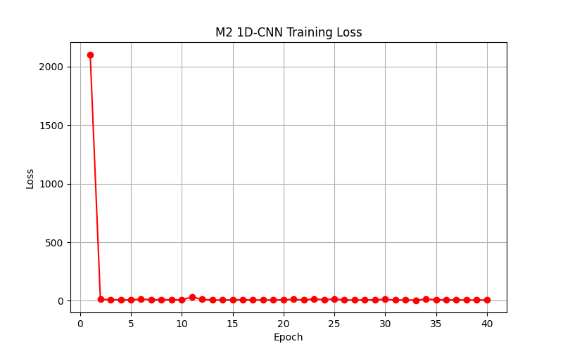

# P5 Deliverables: Methods §3.4 and Results §4.2

## Methods §3.4: M2 - 1D-CNN

For the deep learning method, we use One-Dimensional Convolutional Neural Network (1D-CNN). The model treats the 140 numerical flow features as a 1D sequence. It uses convolutional layers to find local patterns between the features. Then, it uses pooling layers and fully connected layers to output a single attack score. 
To ensure a fair comparison, the training setup follows the same rules as M1. We run the model for a fixed number of epochs without early stopping. Because the dataset is imbalanced, we apply the positive class weights provided by the P2 preprocessor. We use the Adam optimizer to update the model. 
The complexity of M2 is much higher than M1. The CNN requires a lot of computing power and time to train. In this experiment, the CNN was trained on a CPU, which was very slow. In a real network defense system, this high training cost is a big problem.
However, this model has a clear limitation. Network flow features are tabular data. There is no natural spatial relationship between these features. Therefore, the local filters of a CNN cannot learn useful information from the data. We expected that the deep learning model would not easily beat the tree-based model on this specific dataset.

## Results §4.2: M2 Results and Comparison

In the same test setting, M2 (1D-CNN) performed much worse than M1. The test AP of M2 is only 0.699. As a direct comparison, M1 (GBDT) reached a very high AP of 0.9997. 

*Figure X: The training loss curve of M2. The loss drops sharply and stays flat, showing a collapsed local optimum.*
Figure X shows the training loss curve of M2. The loss dropped sharply in the first epoch and then stayed flat. This means the model got stuck in a local optimum. It learned to predict almost all traffic as normal. Because of this, M2 failed to find a valid threshold for the 1% FPR target. The TPR at 1% FPR is 0.0, which means the model missed all attacks at this strict operating point.
There may be two main reasons for this result. First, CNN is not suitable for tabular data. Flow features do not have spatial continuity. The tree-based model (M1) splits the data by axis-aligned cuts, which works much better here. Second, the training cost is unbalanced. M1 only needed a few hundred seconds to train on a CPU. But M2 took dozens of hours and still failed to converge. 
This result shows that on extracted flow features, deep learning is not always the best choice. The traditional tree model is still more powerful, stable, and cheaper for network intrusion detection.